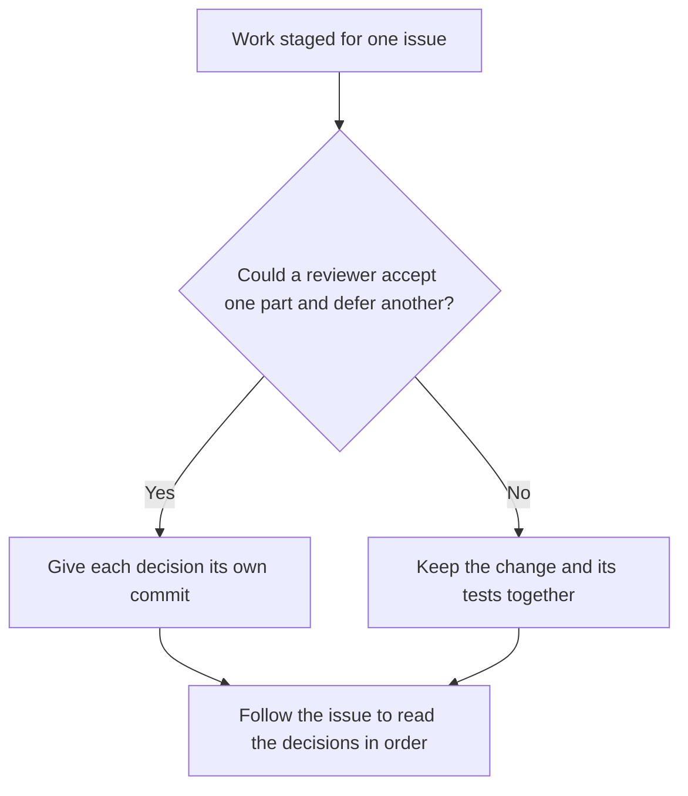

# Gitmoji Triangle

A commit titled “Add permit appeals” tells you what shipped. Six months later,
can you find the commit that set the appeal deadline? When coding agents produce
more changes than a person can read line by line, that distinction matters.

Gitmoji asks the author to name one decision per commit. The first emoji shows
the area, the second shows what changed, and the issue number keeps the story
together. A reviewer looking for a policy change can scan for 👔 and open that diff.

## One issue, several decisions

| A typical unit-of-work commit | The same work as an issue history, oldest first |
| --- | --- |
| Add permit appeals | `🧩👔 #412 (appeals): allow appeals for 30 days`<br>`🧩🛡️ #412 (appeals): reject appeals without a refusal reference`<br>`🎨✨ #412 (portal): let applicants appeal from the refusal notice` |
| Polish the appeal form | `🎨📐 #413 (portal): keep the deadline beside the submit button`<br>`🎨💬 #413 (portal): say when the appeal window closes` |
| Fix inconsistent appeal deadlines | `🧩🪢 #418 (appeals): reuse the filing calendar for reminders`<br>``👌 <`🧩🐛`> #418 (appeals): accept filings on the final day`` |

In the last row, 🪢 marks the removal of duplicate logic. The 👌 commit came
from review. Its optional discussion link takes the next reader to the finding.



The agent skill uses this question when planning work. The CLI checks the commit subject and explains each emoji.

## Install

```sh
installer=$(mktemp)
curl -fsSL https://github.com/D1no/gitmoji/releases/latest/download/install.sh -o "$installer" &&
  sh "$installer" /path/to/your/project
```

The installer downloads the binary for your platform and verifies its checksum. Signatures, PR titles, direct merges and history upgrades run in that binary. Repository operations use Git; hosted operations also use your GitHub credentials.
With a project path, it also installs the skill, settings and Git hooks. Run
`sh "$installer"` by itself to install only the command. The CLI, skill
and vocabulary use one release number. Run `gitmoji --version` to check it.

### Check a project installation

Run `gitmoji doctor` inside a checkout to check the active release, Git hooks, installed skill and enrolled workflows. For a session-start check, `gitmoji doctor --json` emits one array and exits with status 1 when a component needs attention. It works offline and leaves the checkout alone. [Diagnostic fields and examples](package/README.md#check-an-installation)

### Pin the CLI in CI

On GitHub Actions, run `gitmoji init --github-workflows` in the project to install the PR commit check and title sync. Commit the generated workflows. On upgrade, change `[vocabulary].version` and rerun `gitmoji init` to refresh managed copies. [Workflow setup](skills/gitmoji/references/pull-requests.md#enable-automatic-pr-titles)

For other CI systems, run the installer from the project checkout. It reads
`[vocabulary].version` from `gitmoji.toml` or `.config/gitmoji.toml` and installs
that release. The installer uses a local Gitmoji that supports `pin`, or downloads
a temporary reader. It verifies every downloaded binary against its own release’s
`SHA256SUMS`. Installing the CLI requires a POSIX shell, curl or wget, and
sha256sum or shasum. Git is needed only for subsequent repository operations.

```sh
tool=$(mktemp -d)
url=https://github.com/D1no/gitmoji/releases/latest/download/install.sh
curl -fsSL "$url" -o "$tool/install.sh" &&
  GITMOJI_BIN="$tool/bin" sh "$tool/install.sh" --pinned &&
  "$tool/bin/gitmoji" --version
```

With wget, use `wget -q -O "$tool/install.sh" "$url"` for the download. For a
fixed bootstrap, copy the installer URL from a specific release’s assets.
`GITMOJI_BIN` selects the destination directory. If another tool named
`gitmoji` is installed, the installer asks before replacing it. In CI the
collision stops installation unless you pass `--overwrite` or set
`GITMOJI_OVERWRITE=1`. Repeated installs verify the existing binary against the
release checksum and leave an identical executable in place.
Linux and macOS releases cover arm64 and x86_64.

When contributor branches merge, the local Git hook names the incoming branch, its destination and the intentions in the arriving commits. [Local branch merges](skills/gitmoji/references/pull-requests.md#local-branch-merges)

## Pull request titles

An open pull request can show the intentions of its commits before you read the diff:

```text
[`🎨👷` / `✨🔧`] Preview on pull requests
```

Push another commit and Gitmoji refreshes the emoji prefix. Reviewers can edit the words. When the PR lands with GitHub’s merge button, the number appears once at the end, for example `(#42)`. Enable this with the [PR title workflow and merge settings](skills/gitmoji/references/pull-requests.md#enable-automatic-pr-titles).

A 🚧 provisional or 🧪 exploratory commit puts its marker before the title inventory. Projects can opt into a verified follow-up issue, defer selected review findings, and disclose unfinished work in release notes. [Provisional pull requests](skills/gitmoji/references/pull-requests.md#land-a-demo-or-comparison-with-a-follow-up)

When a review prompts a commit, 👌 marks the response and the enclosed emojis identify the change. An optional `Review` link identifies the conversation. An `Addresses` list can point to the individual comments. [Review-response commits](skills/gitmoji/SKILL.md#respond-to-review-feedback)

## Guides

| Guide | What it covers |
| --- | --- |
| [Commit convention](skills/gitmoji/SKILL.md) | Plan, write and check a commit |
| [Pull requests](skills/gitmoji/references/pull-requests.md) | Summarize a PR while preserving the individual decisions it contains |
| [Existing history](skills/gitmoji/references/upgrade-history.md) | Preview changes to historical merge and revert captions |
| [Command](package/README.md) | Build and test the Rust CLI |
| [Skill](skills/README.md) | Install the agent skill |
| [Development](docs/development.md) | Contributor setup and worktrees |
| [Website](website/README.md) | Run the landing page |
| [CI and releases](.github/README.md) | Run checks and publish a release |

Contributors can find repository-specific guidance in [AGENTS.md](AGENTS.md).
See the [changelog](CHANGELOG.md) for release notes and the [MIT license](LICENSE)
for licensing terms.
